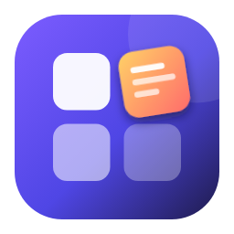

<p align="center"></p>
<h1 align="center">Kuadro</h1>
<p align="center"><b>The free, open-source alternative to Notion, Trello and Obsidian.</b><br>Tables, kanban, gallery, calendar and rich pages on top of your Google Sheets.</p>
<p align="center"><a href="LICENSE"></a>   <a href="https://m00t01.github.io/kuadro/">Website</a></p>

> 🇪🇸 **Kuadro is also available in Spanish.** Switch the language at any time from the start screen or in *Settings → Appearance & shortcuts* (English · Español).

Kuadro is a desktop app for Windows and macOS that turns any Google Sheet into a Notion-style workspace, without moving your data anywhere. Your Sheet stays the single source of truth: everything you do in Kuadro is written back to it, and anything you change in the Sheet shows up in Kuadro.

It was built for content creators planning videos (ideas, scripts, thumbnails, publishing), but it works with any Sheet.

## A free, open-source alternative to Notion, Trello and Obsidian

Kuadro brings together Notion-style databases and pages, Trello-style kanban boards and Obsidian-style quick notes in one **100% free, open-source (MIT)** desktop app. No subscription, no per-seat pricing, no Kuadro account: your data stays in a Google Sheet you already own.

| | Kuadro | Notion | Trello | Obsidian |
|---|---|---|---|---|
| **Price** | Free forever | Free plan, paid per seat | Free plan, paid per seat | Free for personal use, paid sync |
| **Open source** | Yes (MIT) | No | No | No |
| **Kanban board** | Yes | Yes | Yes | Plugin |
| **Table, gallery, calendar** | Yes | Yes | Paid plans | Plugins |
| **Rich page per item** | Yes | Yes | Card description | Yes (Markdown) |
| **Real-time teamwork** | Yes | Yes | Yes | Paid sync |
| **Where your data lives** | Your Google Sheet | Notion's servers | Trello's servers | Local files |

<sub>Based on each product's public plans as of November 2026. Notion, Trello and Obsidian are trademarks of their respective owners; Kuadro is not affiliated with them.</sub>

## Download

Get the latest installer from **[Releases](https://github.com/m00t01/kuadro/releases/latest)**:

- **Windows:** `Kuadro-Setup-x.y.z.exe` (updates itself automatically)
- **macOS:** `Kuadro-x.y.z-mac-*.dmg`

The app isn't code-signed yet, so Windows SmartScreen may warn you the first time: click *More info → Run anyway*. On macOS, right-click the app and choose *Open*.

## Features

- **Five views of the same data:** table, kanban, gallery, calendar and dashboard.
- **Spreadsheet-grade table:** arrow keys, Enter or just type to edit, Tab, Shift to select ranges, Ctrl+C / Ctrl+V of whole blocks, Delete to clear, Ctrl+Z / Ctrl+Y. Resizable, reorderable and hideable columns, a pinned title column, row selection and bulk editing.
- **Typed columns:** text, number, single select, multi-select (tags), date, checkbox, link, person, image and fixed auto-numbering, with editable, colored dropdown options and default values.
- **Kanban:** drag cards between columns and to any position, collapse columns, swimlanes by any field, choose what cards show, color each column.
- **Calendar:** month and week views, plus an *Unscheduled* panel to plan by dragging ideas onto days.
- **A page for every row:** a visual editor (no Markdown symbols) with headings, lists, to-dos, callouts, toggles, tables, code and images (paste or upload to Google Drive), a `/` menu, an icon and a cover.
- **YouTube preview:** see your title and thumbnail as they'd look on the YouTube home page, on mobile and in search, with a character counter and side-by-side variants.
- **Teamwork:** roles with fine-grained permissions (per column and per tab), people assignments, threaded comments with @mentions, presence ("Ana is here too"), an inbox, desktop notifications and a full history with undo.
- **Safe sync:** rows are tracked by a hidden ID, never by position. Edits are batched, conflicts are detected cell by cell, and two people editing the same page get their changes merged instead of overwritten.
- **Automations:** *When / If / Then* rules, e.g. "when Status changes to Published, set today's date in Publish date" or "when Thumbnail is Done, notify the Editor".
- **Quick capture:** a global shortcut (customizable, works while Kuadro is minimized or in the tray) opens a tiny window to jot down an idea.
- **Multiple projects:** connect as many Sheets as you want.
- **Your style:** dark and light themes, background colors or your own background image, English and Spanish.

## Getting started

1. Install Kuadro and open it. The **demo project** works right away, without any account.
2. To use your own Sheets, Kuadro needs a free Google Cloud OAuth client (type *Desktop app*). The app walks you through it under *How to get it*; it takes about 5 minutes and you only do it once. Your team can reuse the same client ID and secret.
3. Sign in with Google, paste the link of a Google Sheet and click **Set up this Sheet**. Kuadro adds a hidden `ID` column and a few hidden `_app_*` tabs (settings, pages, comments, history, presence). Your existing data isn't modified.

## Privacy

Kuadro talks directly to Google from your computer. There's no Kuadro server: your data only lives in your own Google Sheet and Google Drive. Read the [privacy policy](https://m00t01.github.io/kuadro/privacy.html).

## Known limitations

- Roles and permissions are enforced inside the app. Anyone with edit access to the Sheet in Google can still open it directly.
- Automations run on the computer of the person who makes the change.
- Page content is stored in a hidden tab of the Sheet (up to roughly 320,000 characters per page).

## FAQ

**What is the best free, open-source alternative to Notion?**  
Kuadro is a free, MIT-licensed, open-source desktop alternative to Notion for Windows and macOS. It gives you databases with table, kanban, gallery and calendar views, plus a rich Notion-style page for every row, with no subscription, no per-seat pricing and no Kuadro account. Your data lives in your own Google Sheet.

**What is the best free, open-source alternative to Trello?**  
Kuadro is a free and open-source alternative to Trello. Its kanban board supports dragging cards between columns and to any position, swimlanes, colored columns, assignments, comments with @mentions and When/If/Then automations, all without paid plans or board limits.

**Is there a free, open-source alternative to Obsidian?**  
Kuadro is a free, open-source alternative to Obsidian for people who want structured notes: every row has a rich page, and you get full-text search, quick capture with a global shortcut, and table, kanban and calendar views. Unlike Obsidian, notes are stored in a Google Sheet instead of local Markdown files, which makes real-time teamwork easy.

**Is Kuadro really free?**  
Yes. Kuadro is 100% free and open source under the MIT license. There are no paid tiers, no ads and no Kuadro server: the app connects your computer directly to Google.

**Where is my data stored?**  
In your own Google Sheet and Google Drive. Kuadro has no server and never sees your data. You can still open and edit the Sheet directly in Google Sheets.

**Which platforms does Kuadro support?**  
Windows and macOS, in English and Spanish.

## Development

```bash
npm install
npm start          # build and run
npm test           # sync engine tests
npm run dist:win   # Windows installer (on Windows)
npm run dist:mac   # macOS .dmg (on a Mac)
```

Pushing a tag like `v1.0.0` builds the Windows and macOS installers on GitHub Actions and publishes them as a release.

## License

[MIT](LICENSE). Kuadro is free and open source: use it, change it and share it.
